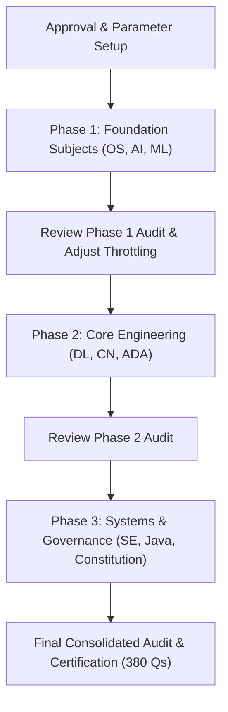

# Enterprise RAG Benchmark: 38-PDF Question Bank & Execution Plan

> **Objective:** Systematically test and validate the Agentic RAG system across all 38 academic course syllabus PDFs in `source_pdfs/` by evaluating 10–12 targeted technical questions per document (380+ questions total).  
> **Execution Policy:** Strict approval-first workflow. No test runner or automated benchmarking will execute without explicit command.

---

## 1. Testing Methodology & Scoring Criteria

Each query submitted through the pipeline will be evaluated across four quantitative dimensions:

1. **Source Document Recall (Weight: 35%)**: Does the top-ranked retrieved context trace back to the target PDF file?
2. **Technical Keyword Coverage (Weight: 30%)**: Does the generated answer contain the exact technical terminology, definitions, and equations expected from the syllabus?
3. **Synthesis Depth & Grounding (Weight: 25%)**: Is the response sufficiently comprehensive (>150 words) with zero hallucinated claims, backed by claim-level verification?
4. **Latency & Execution Health (Weight: 10%)**: Does the 10-step pipeline complete cleanly under 20s without timeout or circuit-breaker trips?

### Status Definitions
* **PASS 🟢**: Target PDF retrieved, ≥75% of key technical terms present, grounded with citations.
* **PARTIAL 🟡**: Valid answer synthesized from adjacent module notes or general technical knowledge, but target PDF ranked lower.
* **FAIL 🔴**: Retrieval failure, empty response, or ungrounded claims.

---

## 2. Complete 38-PDF Question Bank (392 Questions Total)

### Quick Subject Navigation
| Category | Subject Area | Target Documents | Question Count |
| :---: | :--- | :--- | :---: |
| **A** | [Analysis & Design of Algorithms (ADA)](#category-a-analysis-and-design-of-algorithms-ada) | `ADA M-1.pdf` to `ADA M-5.pdf` | 50 Questions |
| **B** | [Artificial Intelligence (AI)](#category-b-artificial-intelligence-ai) | `AI module 1.pdf` to `AI module 5.pdf` | 50 Questions |
| **C** | [Computer Networks (CN)](#category-c-computer-networks-cn) | `CN-module-1.pdf` to `CN-module-5.pdf` | 50 Questions |
| **D** | [Deep Learning (DL)](#category-d-deep-learning-dl) | `DL module 1.pdf` to `DL module 5.pdf` | 50 Questions |
| **E** | [Machine Learning (ML)](#category-e-machine-learning-ml) | `ML module 1.pdf` to `ML module 5.pdf` | 50 Questions |
| **F** | [Operating Systems (OS)](#category-f-operating-systems-os) | `OS All Modules Notes.pdf` | 15 Questions |
| **G** | [Software Engineering (SE)](#category-g-software-engineering-se) | `SE Module 1.pdf` to `SE Module 5.pdf` | 50 Questions |
| **H** | [Java & Object-Oriented Programming](#category-h-java--object-oriented-programming) | `oops's with java Module 1-5`, `Complete JAVA.pdf` | 62 Questions |
| **I** | [Indian Constitution](#category-i-indian-constitution) | `Indian Constitution Notes - All Modules.pdf` | 15 Questions |
| **TOTAL** | **9 Academic Disciplines** | **38 Core Course PDFs** | **392 Questions** |

---

### Category A: Analysis and Design of Algorithms (ADA)

#### 1. `ADA M-1.pdf` (Module 1: Fundamentals of Algorithm Analysis)
1. What is an algorithm and what are the essential criteria (definiteness, finiteness, etc.) it must satisfy?
2. Explain the asymptotic notations: Big-O ($O$), Big-Omega ($\Omega$), and Big-Theta ($\Theta$).
3. What is the difference between best-case, worst-case, and average-case time complexities?
4. How do you set up and solve recurrence relations for recursive algorithms?
5. State and explain the Master Theorem with its three standard cases.
6. Describe the divide-and-conquer paradigm and its general algorithmic structure.
7. Explain the Merge Sort algorithm and analyze its time and space complexity.
8. Describe Quick Sort, its partitioning algorithm, and explain when its worst-case $O(n^2)$ behavior occurs.
9. How can random pivot selection optimize Quick Sort performance?
10. What is the fundamental difference between an algorithm's time complexity and space complexity?

#### 2. `ADA M-2.pdf` (Module 2: Decrease-and-Conquer & Transform-and-Conquer)
1. Explain the decrease-and-conquer strategy and differentiate decrease-by-a-constant versus decrease-by-a-factor.
2. How does Insertion Sort work and what is its worst-case comparison count?
3. Explain Depth-First Search (DFS) on graphs and how DFS trees are used to detect cycles.
4. Describe Breadth-First Search (BFS) and explain how it identifies shortest paths in unweighted graphs.
5. What is topological sorting and what are the two algorithms (DFS-based vs Source Removal) to compute it?
6. Explain the transform-and-conquer strategy with an example like instance simplification.
7. Describe balanced search trees and explain how 2-3 trees maintain balance during insertions.
8. What is a binary heap and how does the bottom-up heap construction algorithm work?
9. Explain Heap Sort step-by-step and show why its time complexity is $O(n \log n)$.
10. Describe Horner's rule for polynomial evaluation and explain why it is computationally efficient.

#### 3. `ADA M-3.pdf` (Module 3: Space-Time Tradeoffs & Dynamic Programming)
1. Explain the concept of space-time tradeoffs in algorithm design.
2. What is Horspool's string matching algorithm and how is the shift table constructed?
3. Explain hashing and describe collision resolution strategies: open addressing vs separate chaining.
4. What is dynamic programming and what are its two core properties: optimal substructure and overlapping subproblems?
5. How does Warshall's algorithm compute the transitive closure of a directed graph?
6. Describe Floyd's algorithm for all-pairs shortest paths and write its recurrence relation.
7. Explain the 0/1 Knapsack problem using dynamic programming and write its recurrence table formula.
8. Differentiate between top-down memoization and bottom-up dynamic programming.
9. What is the Matrix Chain Multiplication problem and how does dynamic programming determine optimal parenthesization?
10. Describe the Longest Common Subsequence (LCS) problem and its dynamic programming formulation.

#### 4. `ADA M-4.pdf` (Module 4: Greedy Technique)
1. Define the greedy algorithm paradigm and explain the greedy-choice property.
2. What is a Minimum Spanning Tree (MST) and what are its fundamental graph properties?
3. Explain Prim's algorithm for finding an MST and state its time complexity.
4. Describe Kruskal's algorithm for finding an MST and explain the role of the Disjoint Set Union (DSU) data structure.
5. Explain Dijkstra's single-source shortest path algorithm and why it fails with negative edge weights.
6. Describe Huffman coding and explain how prefix-free variable-length codes achieve lossless data compression.
7. What is the Fractional Knapsack problem and why can it be solved greedily whereas 0/1 Knapsack cannot?
8. Explain the Job Sequencing with Deadlines problem and the greedy heuristic used to maximize profit.
9. Differentiate between Prim's algorithm and Kruskal's algorithm in terms of sparse versus dense graph efficiency.
10. What is matroid theory and how does it relate to the correctness of greedy algorithms?

#### 5. `ADA M-5.pdf` (Module 5: Limitations of Algorithm Power, Backtracking & Branch-and-Bound)
1. Define the complexity classes: P, NP, NP-Complete, and NP-Hard.
2. Explain the concept of polynomial-time reduction in the context of NP-Completeness.
3. State Cook's Theorem and its significance in computational complexity.
4. What is backtracking and how does it traverse a state-space tree?
5. Explain the $N$-Queens problem and how backtracking prunes illegal board configurations.
6. Describe the Subset Sum problem and show how backtracking explores valid combinations.
7. Explain the Hamiltonian Circuit problem and how backtracking finds valid cycles.
8. What is the branch-and-bound technique and how does it differ fundamentally from backtracking?
9. Explain how branch-and-bound solves the Assignment Problem using lower-bound estimates.
10. Describe the Traveling Salesperson Problem (TSP) and how branch-and-bound finds the optimal tour.

---

### Category B: Artificial Intelligence (AI)

#### 6. `AI module 1.pdf` (Module 1: Introduction & Uninformed Search)
1. Define Artificial Intelligence and differentiate the four definitions: thinking humanly, acting humanly, thinking rationally, acting rationally.
2. What is the Turing Test and what are the core capabilities required to pass it?
3. Describe the PEAS (Performance measure, Environment, Actuators, Sensors) framework for an automated taxi driver.
4. Categorize environments: fully vs partially observable, deterministic vs stochastic, episodic vs sequential, static vs dynamic, discrete vs continuous.
5. Explain the architecture of a Simple Reflex Agent vs a Goal-Based Agent.
6. What is a state-space search problem and what are its five components (initial state, actions, transition model, goal test, path cost)?
7. Explain Breadth-First Search (BFS) and evaluate its completeness, optimality, time, and space complexity.
8. Explain Depth-First Search (DFS) and discuss scenarios where it can get trapped in infinite loops.
9. What is Uniform Cost Search (Dijkstra's search) and what optimality condition must it satisfy?
10. Describe Iterative Deepening Search (IDS) and explain why it combines the advantages of BFS and DFS.

#### 7. `AI module 2.pdf` (Module 2: Informed Search & Local Search)
1. Define informed (heuristic) search and explain how heuristic functions estimate path costs.
2. What is Greedy Best-First Search and what is its primary drawback?
3. Explain the $A^*$ search algorithm and its evaluation function $f(n) = g(n) + h(n)$.
4. Define heuristic admissibility and prove why admissible heuristics guarantee optimality in tree search.
5. Define heuristic consistency (monotonicity) and explain why it is required for graph search.
6. Explain the 8-puzzle problem and compare the Manhattan distance heuristic versus misplaced tiles heuristic.
7. Describe Hill Climbing search and explain the local maxima, ridges, and plateaux problems.
8. What is Simulated Annealing and how does the temperature parameter control probabilistic downhill moves?
9. Explain Genetic Algorithms: chromosome representation, fitness function, selection, crossover, and mutation.
10. Describe Local Beam Search and explain how it differs from running random-restart hill climbing.

#### 8. `AI module 3.pdf` (Module 3: Adversarial Search & CSP)
1. Define games in AI as multi-agent adversarial search problems.
2. Explain the Minimax algorithm and how node values propagate from leaf states.
3. What is Alpha-Beta pruning and how does it optimize Minimax search without altering the final decision?
4. What are the best-case and worst-case time complexities of Alpha-Beta pruning?
5. Describe heuristic evaluation functions in game playing (e.g., Chess, Checkers) and the concept of horizon effect.
6. Define a Constraint Satisfaction Problem (CSP) in terms of variables, domains, and constraints.
7. Explain Arc Consistency (AC-3 algorithm) and how it detects inconsistencies before search.
8. Describe Backtracking search for CSPs and explain the Minimum Remaining Values (MRV) heuristic.
9. Explain the Degree Heuristic and Least Constraining Value (LCV) heuristic in CSP solving.
10. Show how the 8-Queens problem or Map Coloring problem is formulated and solved as a CSP.

#### 9. `AI module 4.pdf` (Module 4: Knowledge Representation & Logic)
1. Explain the architecture of a Knowledge-Based Agent and the roles of TELL and ASK operations.
2. What is the Wumpus World environment and how does an agent use logical inference to navigate safely?
3. Differentiate between syntax, semantics, and entailment in formal logic.
4. Define Propositional Logic: propositional symbols, connectives, and truth table semantics.
5. Explain logical equivalences: De Morgan's laws, contraposition, and distribution rules.
6. What is Conjunctive Normal Form (CNF) and what are the steps to convert propositional formulas to CNF?
7. Explain the Propositional Resolution inference rule and how resolution refutation proves unsatisfiability.
8. Describe the Forward Chaining algorithm for definite clauses and its data-driven reasoning mechanism.
9. Describe the Backward Chaining algorithm and its goal-directed reasoning mechanism.
10. Explain First-Order Logic (FOL): terms, predicates, universal quantifiers ($\forall$), and existential quantifiers ($\exists$).

#### 10. `AI module 5.pdf` (Module 5: Classical Planning & Uncertainty)
1. What is Classical Planning in AI and why are standard search algorithms inefficient for long action plans?
2. Describe the STRIPS representation language: preconditions, add lists, and delete lists.
3. What is the PDDL (Planning Domain Definition Language) and how does it separate domain actions from problem instances?
4. Explain Forward State-Space Search (Progression) versus Backward Search (Regression) in planning.
5. What is a Planning Graph and how does it compute mutual exclusion (mutex) relationships between actions and literals?
6. Why is handling uncertainty essential in real-world AI reasoning?
7. State Bayes' Rule and explain prior probability, posterior probability, and likelihood.
8. What is a Bayesian Belief Network (BBN) and how does it represent conditional independence?
9. Explain how conditional probability tables (CPTs) are constructed for nodes in a Bayesian Network.
10. Describe exact inference in Bayesian Networks by enumeration and its computational complexity.

---

### Category C: Computer Networks (CN)

#### 11. `CN-module-1.pdf` (Module 1: Introduction, OSI & Physical Layer)
1. What is a computer network and what are the primary network topologies (Bus, Star, Ring, Mesh)?
2. Differentiate between LAN, MAN, WAN, and PAN networks.
3. Explain the 7 layers of the OSI Reference Model and list the primary responsibility of each layer.
4. Compare the OSI model with the TCP/IP 4-layer model.
5. Explain guided transmission media (twisted pair, coaxial cable, optical fiber) and their attenuation characteristics.
6. Explain unguided transmission media (radio waves, microwaves, infrared).
7. Describe transmission impairment causes: attenuation, distortion, and noise.
8. State the Nyquist Bit Rate formula and Shannon Channel Capacity formula.
9. Explain circuit switching versus packet switching (virtual circuits vs datagrams).
10. What is multiplexing and differentiate FDM (Frequency Division), TDM (Time Division), and WDM (Wavelength Division)?

#### 12. `CN-module-2.pdf` (Module 2: Data Link Layer & Flow/Error Control)
1. What are the core services provided by the Data Link Layer (framing, flow control, error control)?
2. Explain byte-stuffing and bit-stuffing framing methods with examples.
3. Differentiate between single-bit errors and burst errors.
4. Explain Cyclic Redundancy Check (CRC) error detection using polynomial division.
5. Describe Internet Checksum computation and verification.
6. What is the Stop-and-Wait ARQ protocol and what causes sender deadlock?
7. Explain the Go-Back-N (GBN) sliding window protocol and the sender window size constraint.
8. Explain the Selective Repeat (SR) protocol and explain why its sender and receiver window sizes must satisfy $W \le 2^{m-1}$.
9. What is piggybacking in bidirectional sliding window protocols?
10. Describe High-Level Data Link Control (HDLC) protocol frame format and operational modes.

#### 13. `CN-module-3.pdf` (Module 3: Medium Access Control & Ethernet)
1. What is the Multiple Access problem and why is MAC sublayer required in broadcast channels?
2. Compare Pure ALOHA and Slotted ALOHA in terms of vulnerable period and maximum theoretical throughput.
3. Explain Carrier Sense Multiple Access (CSMA) and differentiate 1-persistent, non-persistent, and p-persistent CSMA.
4. Describe CSMA/CD (Collision Detection) used in wired Ethernet and how collision detection restricts minimum frame size.
5. Explain the Binary Exponential Backoff algorithm used in CSMA/CD.
6. Describe CSMA/CA (Collision Avoidance) used in wireless 802.11 networks and the role of RTS/CTS handshaking.
7. Explain the Hidden Terminal Problem and Exposed Terminal Problem in wireless networks.
8. What is standard Ethernet (IEEE 802.3) and describe the Ethernet frame format (preamble, MAC addresses, type, payload, FCS).
9. Explain the working of network switches and transparent bridge self-learning table algorithm.
10. What is a Virtual LAN (VLAN) and how does IEEE 802.1Q frame tagging isolate broadcast domains?

#### 14. `CN-module-4.pdf` (Module 4: Network Layer & Routing)
1. What are the key functions of the Network Layer (packetizing, routing, forwarding)?
2. Describe IPv4 header format: TTL, Protocol, Header Checksum, Fragmentation offsets (Flags, Fragment Offset).
3. Explain Classful IP addressing (Classes A, B, C, D, E) and explain why CIDR (Classless Inter-Domain Routing) replaced it.
4. What is subnetting and how is a subnet mask used to compute Network ID, Host ID, and Directed Broadcast Address?
5. Explain Network Address Translation (NAT) and differentiate static NAT, dynamic NAT, and PAT (Port Address Translation).
6. Compare IPv4 with IPv6: address length, header simplicity, elimination of checksum, and autoconfiguration.
7. Explain the Distance Vector Routing algorithm (Bellman-Ford) and the Count-to-Infinity problem with Split Horizon solution.
8. Explain Link State Routing (Dijkstra's algorithm) and how Link State Advertisements (LSAs) build global network topology.
9. What is Hierarchical Routing and why is it necessary for large Autonomous Systems?
10. Describe Address Resolution Protocol (ARP) and explain how an IP address is resolved to a MAC address.

#### 15. `CN-module-5.pdf` (Module 5: Transport & Application Layers)
1. What are the differences between process-to-process communication in Transport Layer vs host-to-host in Network Layer?
2. Compare TCP (Transmission Control Protocol) and UDP (User Datagram Protocol) across reliability, overhead, and state.
3. Describe the TCP segment header: sequence number, acknowledgment number, window size, flags (SYN, ACK, FIN, RST, PSH, URG).
4. Explain the TCP Three-Way Handshake connection establishment and Four-Way connection termination.
5. Explain TCP sliding window flow control and how the Receiver Window ($rwnd$) prevents buffer overflow.
6. Describe TCP Congestion Control mechanisms: Slow Start, Congestion Avoidance, Fast Retransmit, and Fast Recovery.
7. Explain the Domain Name System (DNS) architecture: root servers, TLD servers, authoritative servers, recursive vs iterative queries.
8. Describe the Hypertext Transfer Protocol (HTTP): HTTP/1.0 vs HTTP/1.1 persistent connections vs HTTP/2 multiplexing.
9. How does the File Transfer Protocol (FTP) use separate control (port 21) and data (port 20) connections?
10. Describe email protocols: SMTP (push), POP3 (pull), and IMAP (interactive remote mailbox sync).

---

### Category D: Deep Learning (DL)

#### 16. `DL module 1.pdf` (Module 1: Foundations & Neural Network Basics)
1. What is Deep Learning and how does representation learning differ from traditional machine learning?
2. Describe the biological neuron and its mathematical abstraction: the McCulloch-Pitts Perceptron.
3. Why can a single-layer perceptron not solve the XOR problem?
4. What is a Multi-Layer Perceptron (MLP) and what is the role of hidden layers?
5. Explain the Sigmoid activation function, its mathematical definition, and why it causes vanishing gradients.
6. Explain the Hyperbolic Tangent (Tanh) activation function and compare its zero-centered output with Sigmoid.
7. Explain the Rectified Linear Unit (ReLU) activation function and its computational benefits.
8. What is the "Dying ReLU" problem and how do Leaky ReLU and Parametric ReLU (PReLU) address it?
9. Describe Loss Functions for neural networks: Mean Squared Error (MSE) for regression vs Binary Cross-Entropy for classification.
10. What is the Softmax activation function and how does it convert raw model logits into probability distributions?

#### 17. `DL module 2.pdf` (Module 2: Training Deep Networks & Optimization)
1. Explain the Backpropagation algorithm and how the Chain Rule of calculus computes partial derivatives.
2. What are the mathematical causes of Vanishing Gradients and Exploding Gradients during backpropagation?
3. How does gradient clipping prevent exploding gradients during deep network training?
4. Explain weight initialization strategies: Xavier (Glorot) initialization vs He initialization.
5. Describe Stochastic Gradient Descent (SGD) and compare it with Batch Gradient Descent and Mini-Batch SGD.
6. What is Momentum in gradient descent and how does it accelerate through ravines and dampen oscillations?
7. Explain the RMSprop optimization algorithm and how exponentially decaying average of squared gradients adapts learning rates.
8. Describe the Adam (Adaptive Moment Estimation) optimizer and how it combines Momentum and RMSprop.
9. Explain Learning Rate Schedules (step decay, exponential decay, cosine annealing) and warmup strategies.
10. What is the problem of saddle points and local minima in non-convex deep learning loss landscapes?

#### 18. `DL module 3.pdf` (Module 3: Convolutional Neural Networks - CNNs)
1. What is the Convolution operation in image processing and how is it computed using kernels/filters?
2. Explain the fundamental principles of CNNs: local receptive fields, shared weights, and spatial subsampling.
3. Define Stride and Padding (Valid vs Same padding) and show the formula to calculate output spatial dimensions.
4. What is a Feature Map and how do multiple channels capture hierarchical visual abstractions?
5. Explain the role of Pooling Layers: Max Pooling versus Average Pooling.
6. Describe the architecture and historical significance of LeNet-5.
7. What breakthroughs did AlexNet introduce (ReLU, Dropout, GPU training, data augmentation)?
8. Describe the VGG Network architecture and why stacking small $3 \times 3$ filters is superior to large filters.
9. Explain ResNet (Residual Networks) and how residual skip connections ($F(x) + x$) enable training networks of 100+ layers.
10. Describe Inception Networks (GoogLeNet) and how $1 \times 1$ convolutions perform dimensionality reduction.

#### 19. `DL module 4.pdf` (Module 4: Sequence Modeling & RNNs)
1. What is sequential data and why are standard feedforward networks inadequate for modeling variable-length sequences?
2. Explain the architecture of a standard Recurrent Neural Network (RNN) and its hidden state recurrence formula.
3. What is Backpropagation Through Time (BPTT) and how does unfolding the computational graph over time steps work?
4. Explain why standard RNNs suffer severely from vanishing and exploding gradients over long sequences.
5. Describe the Long Short-Term Memory (LSTM) network and explain the role of its constant-error carousel (Cell State).
6. Explain the three gates of an LSTM cell: Forget Gate, Input Gate, and Output Gate.
7. Describe the Gated Recurrent Unit (GRU) and how it simplifies LSTM by combining cell state and hidden state.
8. What is a Bidirectional RNN and why is seeing both past and future context advantageous in NLP tasks?
9. Describe Sequence-to-Sequence (Seq2Seq) encoder-decoder architectures used in machine translation.
10. What is Teacher Forcing during RNN training and what is the exposure bias dilemma?

#### 20. `DL module 5.pdf` (Module 5: Regularization, Generative Models & Attention)
1. What is Overfitting in deep models and how does it manifest in training vs validation loss curves?
2. Explain $L_1$ and $L_2$ Weight Regularization (Weight Decay) and how they constrain parameter weights.
3. Describe the Dropout technique and explain why it acts as an implicit ensemble of sub-networks.
4. Explain Batch Normalization: mathematical formulation during training and inference, and why it speeds up convergence.
5. What is Layer Normalization and why is it preferred over Batch Normalization in NLP and sequence models?
6. Describe Autoencoders: encoder architecture, latent bottleneck representation, and reconstruction loss.
7. What are Variational Autoencoders (VAEs) and explain the reparameterization trick.
8. Explain Generative Adversarial Networks (GANs): Generator vs Discriminator minimax game objective.
9. What was the motivation for the Attention Mechanism in sequence models to overcome the fixed-vector encoder bottleneck?
10. Describe Scaled Dot-Product Attention: Query ($Q$), Key ($K$), Value ($V$), and the self-attention equation.

---

### Category E: Machine Learning (ML)

#### 21. `ML module 1.pdf` (Module 1: Introduction & Concept Learning)
1. Define Machine Learning and state Mitchell's definition ($E, T, P$).
2. Differentiate Supervised Learning, Unsupervised Learning, Semi-Supervised Learning, and Reinforcement Learning.
3. What is Concept Learning and how is it modeled as a search through a hypothesis space?
4. Define the General-to-Specific ordering of hypotheses.
5. Explain the Find-S algorithm and show how it derives a maximally specific hypothesis from positive training instances.
6. What are the major limitations of Find-S (cannot detect inconsistent data, cannot find multiple hypotheses)?
7. Explain the Version Space and how it represents all hypotheses consistent with training examples.
8. Describe the Candidate Elimination algorithm and the update rules for the General boundary ($G$) and Specific boundary ($S$).
9. What is an Inductive Bias and why is an unbiased learner unable to make useful generalizations?
10. Explain how Candidate Elimination handles negative training examples to specialize $G$.

#### 22. `ML module 2.pdf` (Module 2: Decision Trees)
1. What is a Decision Tree and what do internal nodes, branches, and leaf nodes represent?
2. What types of problems are best suited for Decision Tree learning?
3. Define Entropy in information theory and state its mathematical equation.
4. Define Information Gain and explain how it measures expected reduction in entropy.
5. Describe the ID3 (Iterative Dichotomiser 3) algorithm step-by-step.
6. What is the inductive bias of decision tree algorithms (preferring shorter trees with high information gain)?
7. Explain Overfitting in decision trees and describe Pre-pruning versus Post-pruning (reduced-error pruning).
8. What is Gain Ratio and why does C4.5 use it to prevent bias toward attributes with many distinct values?
9. How are continuous-valued attributes incorporated into decision tree split criteria?
10. How do decision trees handle missing attribute values in training instances?

#### 23. `ML module 3.pdf` (Module 3: Neural Networks in ML)
1. Describe the Perceptron training rule and its convergence guarantee for linearly separable data.
2. What is Gradient Descent and how does it minimize the sum of squared errors cost function?
3. What is Delta Rule (Adaline rule) and how does it differ from the Perceptron training rule?
4. Explain the difference between Batch Gradient Descent, Incremental (Stochastic) Gradient Descent, and Mini-batch GD.
5. Why are linear threshold units unable to learn non-linear decision boundaries?
6. Derive the weight update rule for a Sigmoid unit using calculus.
7. Explain the Multi-Layer Feedforward network architecture and the Backpropagation algorithm.
8. What is the role of learning rate ($\eta$) and how does a learning rate that is too large or too small affect convergence?
9. How does adding a Momentum term ($\alpha$) to backpropagation prevent oscillations in error valleys?
10. Explain the generalization capabilities of neural networks and how validation sets guide early stopping.

#### 24. `ML module 4.pdf` (Module 4: Bayesian Learning)
1. State Bayes' Theorem and define Prior Probability, Likelihood, Marginal Probability, and Posterior Probability.
2. What is the Maximum A Posteriori (MAP) hypothesis and Maximum Likelihood (ML) hypothesis?
3. Derive the Naive Bayes Classifier equation from Bayes' theorem.
4. Explain the "Naive" conditional independence assumption: $P(x_1, x_2, \dots, x_n \mid y) = \prod P(x_i \mid y)$.
5. What is the zero-frequency problem in Naive Bayes and how does Laplace Smoothing (add-1 smoothing) resolve it?
6. Describe the Minimum Description Length (MDL) principle and its relation to Occam's Razor.
7. What is Bayesian Belief Network (Bayesian Network) and how does it model directed acyclic dependencies?
8. Explain the Concept of $d$-separation and conditional independence in Bayesian Networks.
9. What is the Expectation-Maximization (EM) algorithm and when is it applied to incomplete/hidden data?
10. How does Naive Bayes perform text classification (e.g., spam detection) using Bag-of-Words features?

#### 25. `ML module 5.pdf` (Module 5: Instance-Based Learning & Evaluation)
1. What is Instance-Based Learning (Lazy Learning) and how does it differ from Eager Learning?
2. Explain the $K$-Nearest Neighbors (KNN) algorithm for classification and regression.
3. What distance metrics (Euclidean, Manhattan, Minkowski) are commonly used in KNN?
4. What is the Curse of Dimensionality and how does it impact distance metrics in high-dimensional feature spaces?
5. Explain Distance-Weighted KNN and how it prevents distant neighbors from corrupting classification.
6. What are Radial Basis Function (RBF) networks and how do localized kernel functions map inputs?
7. Explain Case-Based Reasoning (CBR) and its four-step cycle (Retrieve, Reuse, Revise, Retain).
8. Define Confusion Matrix metrics: True Positive, False Positive, True Negative, False Negative, Precision, Recall, and F1-Score.
9. Explain ROC (Receiver Operating Characteristic) curve and AUC (Area Under Curve).
10. Explain $K$-Fold Cross Validation, Leave-One-Out (LOO) cross-validation, and the Bias-Variance Tradeoff.

---

### Category F: Operating Systems (OS)

#### 26. `OS All Modules Notes.pdf` (Comprehensive OS Notes)
1. What is an Operating System and what are its primary roles as an extended machine and resource allocator?
2. Differentiate between Dual-Mode Operation (User Mode vs Kernel Mode) and explain how hardware mode bits protect OS integrity.
3. What is a System Call and explain the step-by-step mechanism of a software trap transition.
4. Define a Process and describe the contents of a Process Control Block (PCB).
5. Explain the Process State Transition model (New, Ready, Running, Waiting, Terminated).
6. Compare preemptive versus non-preemptive CPU scheduling algorithms: FCFS, SJF, Priority, and Round Robin.
7. What is the Critical Section Problem and explain the three requirements: Mutual Exclusion, Progress, and Bounded Waiting.
8. Explain Peterson's Solution for two-process mutual exclusion and state its hardware limitations on modern CPUs.
9. What are Semaphores? Differentiate between Binary Semaphores (Mutexes) and Counting Semaphores, and write `wait()` and `signal()` primitives.
10. Define Deadlock and state the four necessary Coffman conditions: Mutual Exclusion, Hold and Wait, No Preemption, Circular Wait.
11. Describe Deadlock Avoidance using Dijkstra's Banker's Algorithm with Allocation, Max, Available, and Need matrices.
12. Explain Paging memory management: Logical vs Physical address translation, Page Tables, and Translation Lookaside Buffers (TLB).
13. What is Virtual Memory and explain the Demand Paging mechanism and Page Fault handling sequence.
14. Explain Page Replacement Algorithms: FIFO, Optimal (OPT), Least Recently Used (LRU), and Belady's Anomaly.
15. What is Thrashing and how does the Working Set Model prevent catastrophic CPU utilization collapse?

---

### Category G: Software Engineering (SE)

#### 27. `SE Module 1.pdf` (Module 1: Introduction to SE & Process Models)
1. Define Software Engineering and explain the causes of the historic "Software Crisis".
2. What are software characteristics that distinguish software from traditional industrial manufacturing products?
3. Describe the Classical Waterfall Model, its sequential stages, and explain why late-stage requirement changes are costly.
4. Explain the Prototyping Model and describe scenarios where throwaway prototypes are necessary.
5. Describe the Spiral Model and explain why it is described as risk-driven.
6. What is the Agile Manifesto and what are its four core values compared to plan-driven models?
7. Describe the Scrum Framework: Product Owner, Scrum Master, Development Team, Sprint, Backlog, and Daily Standup.
8. What is Extreme Programming (XP) and describe its core practices (Pair Programming, Test-Driven Development).
9. Explain the Rational Unified Process (RUP) and its four phases: Inception, Elaboration, Construction, Transition.
10. Compare the Waterfall model with Agile development across project size, requirement stability, and customer involvement.

#### 28. `SE Module 2.pdf` (Module 2: Requirements Engineering)
1. What is Requirements Engineering and what are the activities involved in the requirements process?
2. Differentiate between Functional Requirements and Non-Functional Requirements (NFRs) with concrete examples.
3. What is Requirement Elicitation and describe techniques: Interviews, Surveys, Workshops, Brainstorming, and Observation.
4. What is a Software Requirements Specification (SRS) document and what qualities (unambiguous, complete, verifiable) must it possess?
5. Explain the IEEE 830 standard structure for an SRS document.
6. What is Requirement Validation and describe methods like requirements reviews, prototyping, and test-case generation.
7. Explain Requirement Traceability and how a Traceability Matrix maps requirements to design, code, and test cases.
8. What is Requirement Creep (Scope Creep) and how does change impact analysis prevent project derailment?
9. Describe Use Case Modeling: Actors, Use Cases, System Boundary, and include vs extend relationships.
10. What is Feasibility Study and describe its dimensions: Technical, Economic, Operational, Legal, and Schedule feasibility.

#### 29. `SE Module 3.pdf` (Module 3: Software Design & Modularity)
1. What is Software Design and explain the transition from "what" (analysis) to "how" (design).
2. Differentiate between Architectural Design, High-Level Design, and Detailed Design.
3. What is Modularity and explain why decomposing complex systems into independent modules is advantageous?
4. Define Cohesion and explain its levels: Coincidental, Logical, Temporal, Procedural, Communicational, Sequential, and Functional.
5. Define Coupling and explain its levels: Content, Common, Control, Stamp, and Data coupling.
6. Why is "High Cohesion and Low Coupling" the universal golden rule of software architecture?
7. Explain Information Hiding and Data Abstraction as fundamental software design principles.
8. Describe Object-Oriented Design principles (SOLID principles: Single responsibility, Open-closed, Liskov, Interface segregation, Dependency inversion).
9. What is UML (Unified Modeling Language) and differentiate Structural Diagrams (Class, Component) versus Behavioral Diagrams (Sequence, Activity).
10. Explain Architectural Styles: Layered (n-tier), Client-Server, Microservices, and Event-Driven architecture.

#### 30. `SE Module 4.pdf` (Module 4: Software Testing & QA)
1. Define Software Testing and differentiate between Fault (Defect/Bug), Failure, and Error.
2. What is the difference between Software Verification ("Are we building the product right?") and Validation ("Are we building the right product?")?
3. Describe the V-Model and show how each testing phase correlates with a development phase.
4. Explain Black-Box Testing (Functional Testing) and describe Equivalence Class Partitioning.
5. What is Boundary Value Analysis (BVA) and why do software errors cluster heavily at input boundaries?
6. Explain White-Box Testing (Structural Testing) and describe Statement Coverage, Branch Coverage, and Condition Coverage.
7. What is Basis Path Testing and how is McCabe's Cyclomatic Complexity calculated ($V(G) = E - N + 2P$)?
8. Differentiate between Unit Testing, Integration Testing (Top-Down, Bottom-Up, Big Bang), and System Testing.
9. What is Regression Testing and why is automated test suite execution critical during continuous changes?
10. Describe Alpha Testing and Beta Testing and their roles in user acceptance testing (UAT).

#### 31. `SE Module 5.pdf` (Module 5: Maintenance, SCM & Project Management)
1. What is Software Maintenance and explain its four categories: Corrective, Adaptive, Perfective, and Preventive.
2. What is Software Configuration Management (SCM) and why is baseline control essential?
3. Explain the core activities of SCM: Configuration Identification, Version Control, Change Control, Configuration Auditing.
4. What is a Software Quality Assurance (SQA) plan and describe formal technical reviews (FTR) and code inspections.
5. Describe ISO 9001 and SEI CMM (Capability Maturity Model) and explain the 5 levels of CMM (Initial, Repeatable, Defined, Managed, Optimizing).
6. What is Software Project Management and describe the triple constraint: Scope, Time, and Cost.
7. Explain Software Cost Estimation: LOC (Lines of Code) and Function Point (FP) analysis.
8. Describe the COCOMO (Constructive Cost Model) model: Basic, Intermediate, and Detailed COCOMO for Organic, Semidetached, and Embedded systems.
9. What is Software Risk Management? Explain Risk Identification, Risk Projection, Risk Mitigation, Monitoring, and Management (RMMM) plan.
10. Describe project scheduling tools: Work Breakdown Structure (WBS), Gantt Charts, and PERT/CPM critical path analysis.

---

### Category H: Java & Object-Oriented Programming

#### 32. `oops's with java Module 1.pdf` (Java Module 1: OOP Basics & Syntax)
1. What is Object-Oriented Programming and contrast it with Procedure-Oriented Programming.
2. Explain the fundamental principles of OOP: Encapsulation, Abstraction, Inheritance, and Polymorphism.
3. What is a Class and what is an Object in Java? How does memory allocation work using the `new` operator?
4. Explain Primitive Data Types in Java and their memory sizes (byte, short, int, long, float, double, char, boolean).
5. What is type casting in Java? Differentiate between Implicit (Widening) and Explicit (Narrowing) casting.
6. Describe Java control statements: Selection statements (`if-else`, `switch`), Iteration statements (`for`, `while`, `do-while`), Jump statements (`break`, `continue`, `return`).
7. How does the enhanced `for-each` loop work in Java arrays?
8. Explain one-dimensional and two-dimensional array declaration, instantiation, and initialization in Java.
9. What are command-line arguments in Java and how does `public static void main(String[] args)` receive them?
10. Explain Java's automatic Garbage Collection philosophy and why Java eliminates explicit pointers.

#### 33. `oops's with java Module 2.pdf` (Java Module 2: Methods & Constructors)
1. What is a method in Java and describe its signature, return types, and parameter passing mechanisms.
2. Explain Call by Value versus Call by Reference in Java, and prove why Java is strictly Call by Value.
3. What is a Constructor in Java? Differentiate between Default Constructors and Parameterized Constructors.
4. What is Constructor Overloading and how is it used to initialize objects in multiple ways?
5. Explain the `this` keyword and its uses: resolving instance variable shadowing and constructor chaining (`this()`).
6. What is Method Overloading and what are the rules regarding parameter types, counts, and return types?
7. Explain the `static` keyword: static variables (class variables), static methods, and static initialization blocks.
8. What restrictions apply to `static` methods (cannot access non-static members directly, cannot use `this` or `super`)?
9. Describe the `finalize()` method in Java and explain when the garbage collector invokes it.
10. What are inner classes (nested classes) in Java and how do static nested classes differ from non-static inner classes?

#### 34. `oops's with java Module 3.pdf` (Java Module 3: Inheritance & Polymorphism)
1. What is Inheritance in Java and explain single, multilevel, and hierarchical inheritance models.
2. Why does Java not support multiple inheritance with classes?
3. Explain the `super` keyword and its uses: accessing superclass members and invoking superclass constructors (`super()`).
4. What is Method Overriding in Java and what are the rules regarding method names, signatures, and access levels?
5. Explain Dynamic Method Dispatch (Runtime Polymorphism) in Java with an inheritance hierarchy.
6. What is an Abstract Class and an Abstract Method? What are the rules regarding abstract class instantiation?
7. Explain the `final` keyword in Java: final variables (constants), final methods (prevent overriding), and final classes (prevent inheritance).
8. Describe the `Object` class in Java and explain its key methods: `toString()`, `equals()`, `hashCode()`, `getClass()`.
9. Explain the difference between compile-time polymorphism (overloading) and runtime polymorphism (overriding).
10. What is downcasting versus upcasting in Java object references and how is the `instanceof` operator used safely?

#### 35. `oops's with java Module 4.pdf` (Java Module 4: Packages & Interfaces)
1. What is a Package in Java and explain how packages provide namespace management and access protection.
2. How do you create and import user-defined packages in Java?
3. Explain the four access protection specifiers in Java: `public`, `protected`, default (package-private), and `private`.
4. What is an Interface in Java and explain how interfaces achieve 100% abstraction and multiple inheritance.
5. What are the rules for defining variables and methods in a standard Java interface?
6. How does a class implement multiple interfaces and resolve method name collisions?
7. Explain Interface Inheritance: how can one interface extend another interface using the `extends` keyword?
8. What are Default Methods and Static Methods in interfaces (introduced in Java 8) and why were they added?
9. What is a Marker Interface (Tagging Interface) with examples like `Serializable` and `Cloneable`?
10. Compare an Abstract Class with an Interface across inheritance, constructor presence, state storage, and performance.

#### 36. `oops's with java Module 5.pdf` (Java Module 5: Exception Handling & Multithreading)
1. What is an Exception in Java and explain the Java Exception Hierarchy rooted at `java.lang.Throwable`.
2. Differentiate between Checked Exceptions (compile-time) and Unchecked Exceptions (runtime).
3. Explain the five keywords in Java exception handling: `try`, `catch`, `finally`, `throw`, and `throws`.
4. How do multiple `catch` blocks work and what is the rule regarding the order of subclass vs superclass exceptions?
5. What is the role of the `finally` block and under what rare circumstances does `finally` not execute?
6. How do you define and instantiate a custom (user-defined) Exception class in Java?
7. What is Multithreading and differentiate between process-based multitasking and thread-based multitasking.
8. Describe the Thread Life Cycle in Java: New, Runnable, Running, Blocked/Waiting, and Terminated states.
9. Explain the two ways of creating threads in Java: extending `Thread` class vs implementing `Runnable` interface.
10. What is Thread Synchronization, why do race conditions occur, and how does the `synchronized` keyword (methods/blocks) prevent them?

#### 37. `Complete JAVA.pdf` (Comprehensive Java Platform & Collections)
1. Describe the Java Virtual Machine (JVM) architecture: ClassLoader, Memory Areas (Heap, Stack, Method Area), and Execution Engine (JIT).
2. What is the Java Memory Model (JMM) and how does thread memory cache interact with the main memory heap?
3. Explain the Java Collections Framework (JCF) hierarchy: `Collection`, `List`, `Set`, `Queue`, and `Map`.
4. Compare `ArrayList` versus `LinkedList` in terms of internal data structure, search time, and insertion/deletion time complexity.
5. Compare `HashSet`, `LinkedHashSet`, and `TreeSet` across ordering guarantees, uniqueness, and underlying data structures.
6. Explain the `HashMap` internal architecture: hashing, buckets, collision handling via linked lists, and treeification in Java 8.
7. What is the contract between `equals()` and `hashCode()` methods in Java and what happens when it is violated?
8. Describe Java Generics: type parameters ($<T>$), bounded type parameters, and wildcards ($?$ extends, $?$ super).
9. Explain Java I/O Streams: Byte Streams (`InputStream`/`OutputStream`) versus Character Streams (`Reader`/`Writer`).
10. What are Lambda Expressions and Functional Interfaces (`Predicate`, `Function`, `Consumer`, `Supplier`) in modern Java?
11. Describe the Java Stream API and distinguish between intermediate operations (`filter`, `map`) and terminal operations (`collect`, `forEach`).
12. What are Wrapper Classes in Java and explain Autoboxing and Unboxing.

---

### Category I: Indian Constitution

#### 38. `Indian Constitution Notes - All Modules.pdf` (Comprehensive Indian Constitution)
1. Describe the historical background and the role of the Constituent Assembly in drafting the Indian Constitution.
2. Explain the Preamble to the Indian Constitution and its key philosophical ideals: Sovereign, Socialist, Secular, Democratic, Republic, Justice, Liberty, Equality, Fraternity.
3. What are Fundamental Rights under Part III of the Constitution (Articles 12 to 35)?
4. Explain Article 14 (Right to Equality) and Article 21 (Protection of Life and Personal Liberty) and their expansive judicial interpretations.
5. What are Constitutional Remedies under Article 32 and describe the five writs: Habeas Corpus, Mandamus, Prohibition, Certiorari, and Quo-Warranto.
6. What are the Directive Principles of State Policy (DPSP) under Part IV and contrast their non-justiciable nature with Fundamental Rights.
7. What are Fundamental Duties under Article 51A and by which Constitutional Amendment were they incorporated?
8. Describe the Union Executive: Election, powers, functions, and impeachment procedure of the President of India.
9. Explain the role and executive authority of the Prime Minister and the Cabinet under the principle of collective responsibility.
10. Describe the bicameral Parliament of India: Composition, powers, and legislative relationship between Lok Sabha and Rajya Sabha.
11. Explain the jurisdiction of the Supreme Court of India: Original, Appellate, Advisory, and Review jurisdictions.
12. Describe the Emergency Provisions under the Constitution: National Emergency (Article 352), State Emergency/President's Rule (Article 356), and Financial Emergency (Article 360).
13. Explain the Constitutional Amendment procedure under Article 368 and the three types of majorities required.
14. What is the Doctrine of Basic Structure articulated in the landmark *Kesavananda Bharati v. State of Kerala* (1973) case?
15. Explain Indian Federalism and the distribution of legislative powers across the Union List, State List, and Concurrent List in the Seventh Schedule.

---

## 3. Phased Testing & Execution Plan

To evaluate all 38 PDFs without hitting model rate limits or overloading system memory, testing will follow a strictly controlled, phased workflow:

### Execution Strategy Details:
* **Controlled Batching:** Queries will execute subject-by-subject (10 questions per PDF), allowing pauses between modules.
* **Intelligent Rate Limiter:** Built-in 3.5s inter-query pacing ensuring compliance with API limits (15 RPM).
* **Automated Audit Logging:** Every executed query will log:
  1. Full synthesized answer
  2. Retrieved source filenames & chunk page numbers
  3. Wall-clock latency (ms)
  4. Pass/Fail status based on syllabus keyword matches
* **Consolidated Report Output:** All results will be aggregated into `FULL_AUDIT_REPORT.md` with pass percentages per subject and per PDF.

---

## 4. Next Steps & User Confirmation

Please review this question bank and execution plan. When you are ready to begin testing, select how you would like to proceed:

1. **Option 1:** Run **Phase 1** first (OS, AI, ML — ~70 questions) to verify retrieval before continuing.
2. **Option 2:** Run a specific target PDF (e.g., `OS All Modules Notes.pdf` or `CN-module-1.pdf`).
3. **Option 3:** Execute the full 38-PDF automated suite sequentially in the background with live reporting.
